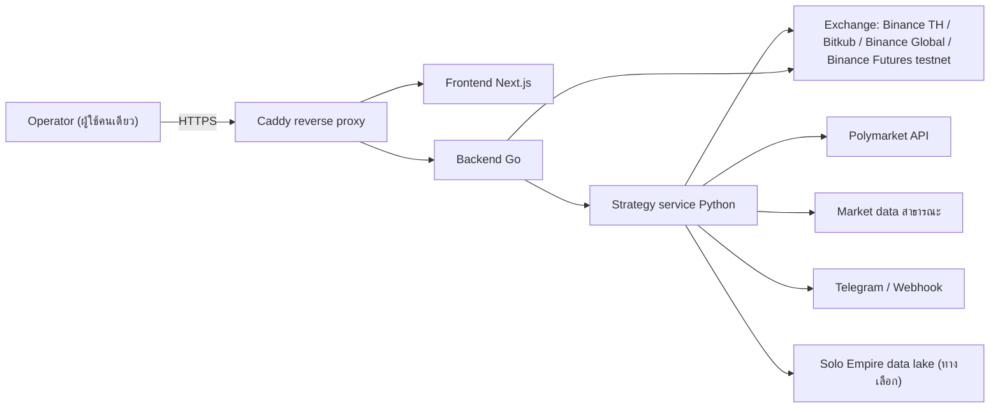
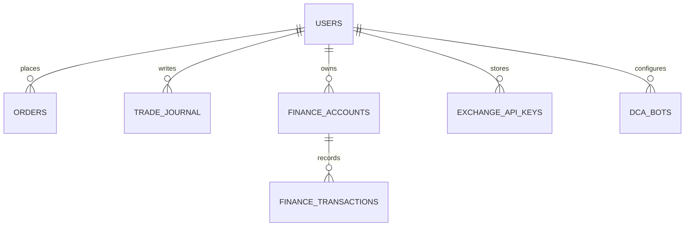
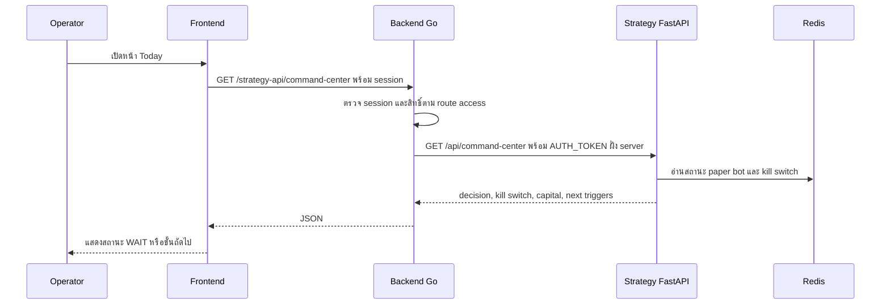
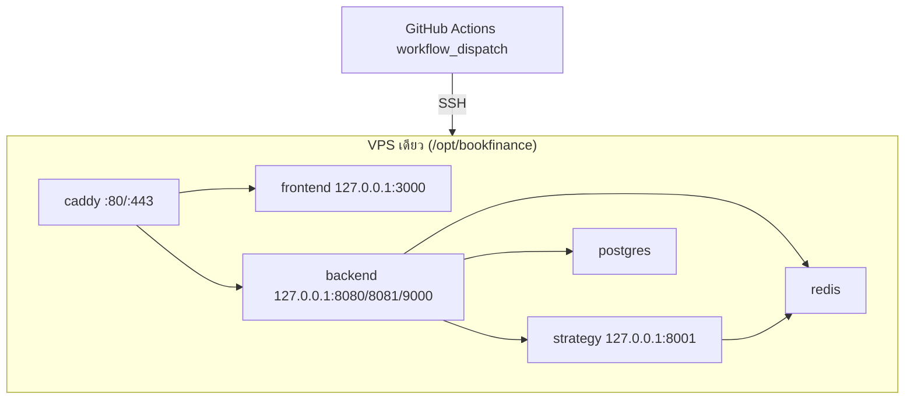

# BookFinance — System Architecture

## 1. Context diagram

ระบบภายนอกที่เรียกจริงในโหมดปัจจุบันจำกัดที่ข้อมูลตลาดแบบอ่านอย่างเดียวและ testnet; คำสั่งเงินจริงถูกบล็อกตาม `POLY_DRY_RUN` และ readiness gate การเชื่อม data lake ใช้เฉพาะงาน research และ test จะ skip เมื่อไม่มี runtime (`.github/workflows/ci-cd.yml` หมายเหตุ lake round-trip)

## 2. Components / containers

| Container | เทคโนโลยี | หน้าที่ | พอร์ต (dev) | หลักฐาน |
|---|---|---|---|---|
| `frontend` | Next.js 15.5, React 19, Tailwind, Vitest, Playwright | Dashboard สองภาษา (`/[lang]/dashboard/*`), อ่าน `/api/command-center` | 3001 (dev) / 3000 (prod) | `frontend/package.json`, `frontend/src/app` |
| `backend` | Go (hexagonal: `adapter`, `domain`, `port`) | HTTP API, WebSocket, gRPC, auth, route access, proxy `/strategy-api`, paper engine, finance module | 8080 HTTP, 8081 WS, 9000 gRPC | `backend/cmd/main.go`, `backend/internal/adapter/http` |
| `strategy` | Python 3.11, FastAPI/uvicorn | กลยุทธ์, paper bots, kill switch, backtest, market intel, command center | 8000 | `strategy/app/main.py`, `strategy/infrastructure/api/app.py` |
| `postgres` | TimescaleDB (pg16) | ข้อมูลผู้ใช้, orders, trades, journal, finance, klines | 5432 (loopback) | `docker-compose.yml`, `backend/migrations` |
| `redis` | Redis 7 | pub/sub, cache, session, สถานะ paper bot (`poly_paper:state`) | 6379 (loopback) | `docker-compose.yml`, `strategy/RUNBOOK.md` |
| `caddy` | Caddy 2 | TLS อัตโนมัติ, reverse proxy, ตั้ง `X-Real-IP` | 80/443 | `Caddyfile`, `docker-compose.prod.yml` |
| monitoring | Prometheus config | เก็บ metrics | — | `monitoring/prometheus.yml` |

### 2.1 โมดูลสำคัญ

- Backend `internal/adapter`: `database`, `dex`, `exchange` (รวม Bitkub v3 order reconcile), `grpcserver`, `http`, `redis`, `repository`, `websocket`
- Backend `internal/domain/service`: grid position/reconcile, bot safety, paper engine fill, signal trade, finance
- Strategy `app/`: `grid_bot.py`, `real_grid_bot.py`, `dca_bot.py`, `futures_bot.py`, `arbitrage*.py`, `backtester.py`, `futures_backtest.py`, `risk_manager.py`, `paper_execution.py`, `polymarket/`, `market_intel/`, `alpha/`, `brain/`, `world/`, `portfolio/`, `telegram_bot.py`, `webhook_notifier.py`
- `proto/trading.proto` สำหรับ gRPC

## 3. Tech stack

| ชั้น | เทคโนโลยี |
|---|---|
| Frontend | Next.js 15.5, React 19, TypeScript, Tailwind, Vitest, Playwright |
| Backend | Go (CI ใช้ 1.21), gRPC, WebSocket |
| Strategy | Python 3.11, FastAPI, uvicorn, httpx, pytest, ruff |
| ข้อมูล | PostgreSQL/TimescaleDB, Redis |
| Infra | Docker Compose, Caddy, GitHub Actions, Prometheus |

## 4. Data stores

| Store | ข้อมูลหลัก | Schema |
|---|---|---|
| PostgreSQL | users, orders, trades, journal, notifications, SL/TP, exchange API keys (เข้ารหัสด้วย `ENCRYPTION_KEY` **[ต้องยืนยัน]** วิธีเข้ารหัส), finance (accounts, transactions, budgets, net worth), audit, DCA bots, klines, telegram users, paper trading, alert history, copy trading, rebalancing, DEX, real trading, portfolio snapshots, price alerts | migrations `001`–`022` ใน `backend/migrations` |
| Redis | state ของ paper bot, kill override, pub/sub event, cache | key ที่ระบุ: `poly_paper:state`, `poly_paper:kill_override` |
| ไฟล์ | รายงาน grid ใน `reports/grid-bot`, research output | — |

ชื่อ entity ใน ER เป็นการย่อจากชื่อ migration **[ต้องยืนยัน]** ชื่อตารางจริงก่อนใช้อ้างอิงเชิงเทคนิค

## 5. Integrations

| ระบบ | ทิศทาง | ใช้ทำอะไร | สถานะ |
|---|---|---|---|
| Binance TH / Bitkub | backend + strategy → exchange | balance, ticker, order (grid) | adapter มีแล้ว; การใช้เงินจริงต้องผ่าน gate |
| Binance Global / USDⓈ-M Futures | strategy → exchange | research, futures paper/testnet | mainnet ถูกปฏิเสธโดย engine |
| Polymarket | strategy → API | markets, orderbook, paper bot | อ่านอย่างเดียว + paper |
| Telegram / webhook | strategy → ผู้ใช้ | แจ้งเตือน kill switch และเหตุการณ์ | **[ต้องยืนยัน]** ว่าเปิดใช้งานอยู่ |
| EVM/Solana providers | strategy → RPC | on-chain intel, preflight | ใช้ใน research **[ต้องยืนยัน]** ขอบเขตการใช้งาน |

### 5.1 ลำดับการเรียก Command Center

## 6. Deployment topology

- Production compose ผูกพอร์ตภายในกับ loopback เท่านั้น เปิดสู่ภายนอกเฉพาะ Caddy 80/443 (`docker-compose.prod.yml`)
- Job `deploy` ทำ `git pull` + `docker compose up -d --build` ผ่าน SSH เมื่อสั่ง `workflow_dispatch` พร้อม `deploy_production=true` เท่านั้น
- โฮสต์ production จริงยังไม่มี (Gate 4 "Need domain/secrets/prod env") **[ต้องยืนยัน]**

## 7. ADR สำคัญ

| ID | การตัดสินใจ | เหตุผล | หลักฐาน |
|---|---|---|---|
| ADR-01 | แยก Go (API/WS/gRPC) กับ Python (กลยุทธ์/พยากรณ์) | ใช้จุดแข็งของแต่ละภาษา | `PRODUCT.md` |
| ADR-02 | `/api/command-center` เป็นแหล่งความจริงเดียวของ dashboard | ลดการตัดสินใจจากตัวเลขไม่ตรงกัน | `strategy/RUNBOOK.md` |
| ADR-03 | ใช้ `paper_bot` เป็น risk source หลัก แยกจาก grid `risk_manager` | ป้องกันการใช้ drawdown 0% ของ grid มาปลด gate | `docs/READINESS_CHECKLIST.md` |
| ADR-04 | Default observe-only, หน้าที่มี action ซ่อนหลัง `NEXT_PUBLIC_ADVANCED_UI` | ลดการลงมือก่อนมีหลักฐาน | `frontend/src/components/Sidebar.tsx` |
| ADR-05 | Browser เรียก strategy ผ่าน `/strategy-api` ที่ backend ตรวจ session และเติม `AUTH_TOKEN` ฝั่ง server; write เป็น admin เท่านั้น | ไม่ให้ token service อยู่ใน browser | `backend/internal/adapter/http/strategy_proxy.go`, git log 2026-09-30/10-01 |
| ADR-06 | Deploy production เป็น manual เท่านั้น | กันการปล่อยโค้ดที่แตะเงินโดยไม่ตั้งใจ | `.github/workflows/ci-cd.yml` |

## การอนุมัติ

| บทบาท | สถานะ | วันที่ | ลงนาม |
|---|---|---|---|
| Solution Architect (Book Dev) | รอตรวจ | — | [ต้องยืนยัน] |

## แหล่งข้อมูล

- `README.md` §Architecture, §Project Structure
- `docker-compose.yml`, `docker-compose.prod.yml`, `Caddyfile`, `monitoring/prometheus.yml`
- `backend/cmd/main.go`, `backend/internal/`, `backend/migrations/`, `proto/trading.proto`
- `backend/internal/adapter/http/strategy_proxy.go`, `backend/internal/adapter/http/route_access.go`
- `strategy/app/`, `strategy/infrastructure/api/app.py`, `strategy/app/backend_auth.py`
- `.github/workflows/ci-cd.yml`
