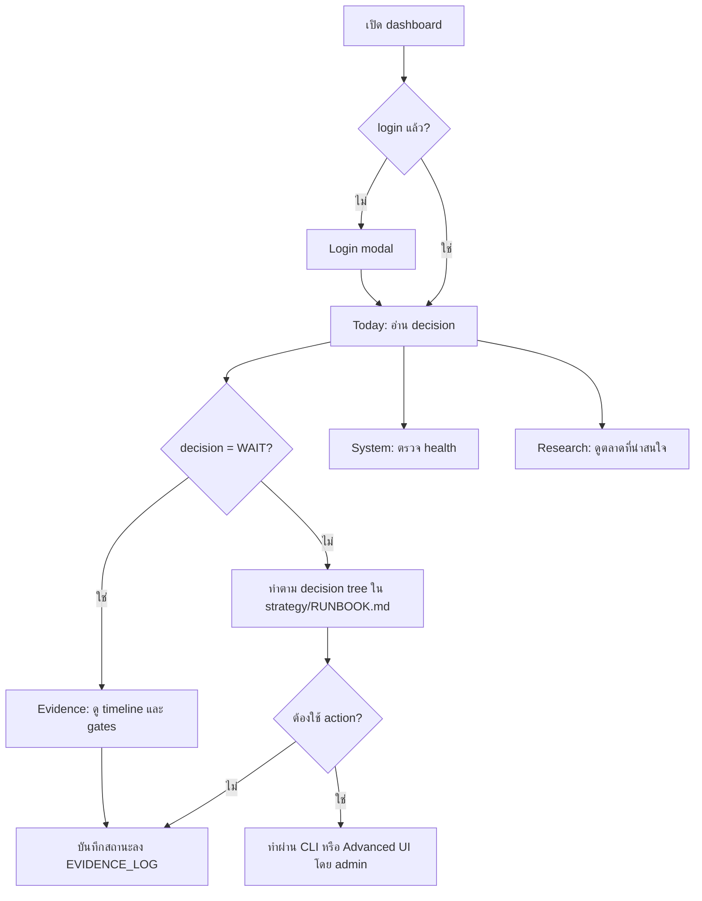
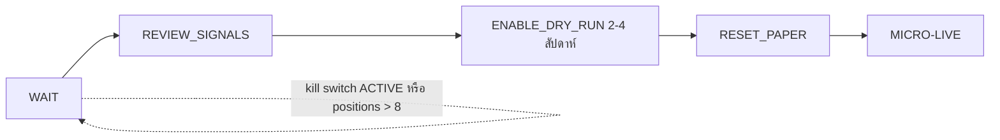
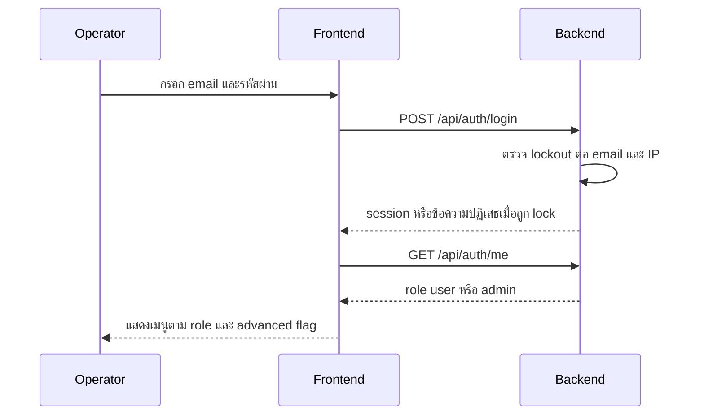

# BookFinance — User Flow และ Screen Inventory

## 1. รายการหน้าจอ

ทุกหน้าอยู่ใต้ `frontend/src/app/[lang]/` (`lang` = `th` หรือ `en`) README ระบุการจัดกลุ่ม route 38 รายการ: 5 keep-main, 14 extracted-to-component, 8 advanced-only, 11 hidden/deferred การแบ่ง advanced/hidden ต่อหน้าด้านล่างอ้างจากกลุ่มใน README และ `Sidebar.tsx` **[ต้องยืนยัน]** รายการต่อหน้าที่แน่นอน

| ID | Route | ชื่อ | บทบาท | สถานะ |
|---|---|---|---|---|
| SC-00 | `/[lang]` | Landing | public | มีแล้ว (e2e `landing.spec.ts`) |
| SC-01 | `/[lang]/dashboard` | Today (Command Center) | user | Core 5 |
| SC-02 | `/[lang]/dashboard/evidence` | Evidence | user | Core 5 |
| SC-03 | `/[lang]/dashboard/research` | Research | user | Core 5 |
| SC-04 | `/[lang]/dashboard/system` | System | user | Core 5 |
| SC-05 | `/[lang]/dashboard/daily-report` | Daily Report | user | Core 5 |
| SC-06 | `/[lang]/dashboard/settings` | Settings | user | รอง |
| SC-07 | `/[lang]/dashboard/paper-trading`, `grid-trading`, `dca`, `polymarket`, `arbitrage`, `copy-trading`, `rebalancing`, `trading`, `bot`, `strategy` | หน้าเทรด/บอท | admin | Advanced (`NEXT_PUBLIC_ADVANCED_UI`) |
| SC-08 | `/[lang]/dashboard/analytics`, `backtest`, `portfolio`, `market-intel`, `sentiment`, `risk-management` | Analytics | user | รอง/advanced **[ต้องยืนยัน]** |
| SC-09 | `/[lang]/dashboard/alerts`, `monitoring`, `history`, `wallet`, `finance`, `money`, `trade-journal` | Operations | user | รอง/hidden **[ต้องยืนยัน]** |
| SC-10 | `/[lang]/dashboard/ai-insights`, `news`, `dex`, `docs` | อื่น ๆ | user | รอง/hidden **[ต้องยืนยัน]** |
| SC-11 | Login modal (`LoginModal.tsx`) | Login | public | มีแล้ว |

## 2. User flow หลัก

### 2.1 Flow รายวันของ operator

### 2.2 Flow การเลื่อน readiness gate

### 2.3 Login และสิทธิ์

## 3. Design system / component

- `DESIGN.md` — "The Pocket App": no-scroll, touch-first, เป้าสัมผัส 44px, รองรับ safe-area; มีส่วน Colors, Typography, Elevation, Components, Do's and Don'ts
- Component หลัก: `Sidebar.tsx` (ซ่อน advanced), `MobileBottomNav.tsx`, `ErrorBoundary` (มีปุ่ม retry ทุกหน้า), `SystemHealthCheck`, `LoginModal`, empty states, toast ผ่าน EventBus → AlertService
- Theme มืด/สว่างอัตโนมัติ, responsive, i18n TH/EN (README ระบุ 200+ translation keys)
- ข้อความ 403 ภาษาไทยเมื่อสิทธิ์ไม่พอ (git log 2026-10-01 "show Thai 403 notices", `forbidden.test.ts`)

## การอนุมัติ

| บทบาท | สถานะ | วันที่ | ลงนาม |
|---|---|---|---|
| UX/UI (Book Dev) | รอตรวจ | — | [ต้องยืนยัน] |

## แหล่งข้อมูล

- `frontend/src/app/[lang]/dashboard/`, `frontend/src/components/Sidebar.tsx`, `frontend/src/components/MobileBottomNav.tsx`
- `frontend/e2e/landing.spec.ts`, `frontend/src/services/forbidden.test.ts`
- `DESIGN.md`, `README.md` §User Experience, `strategy/RUNBOOK.md` §Dashboard UI, §Decision Tree
